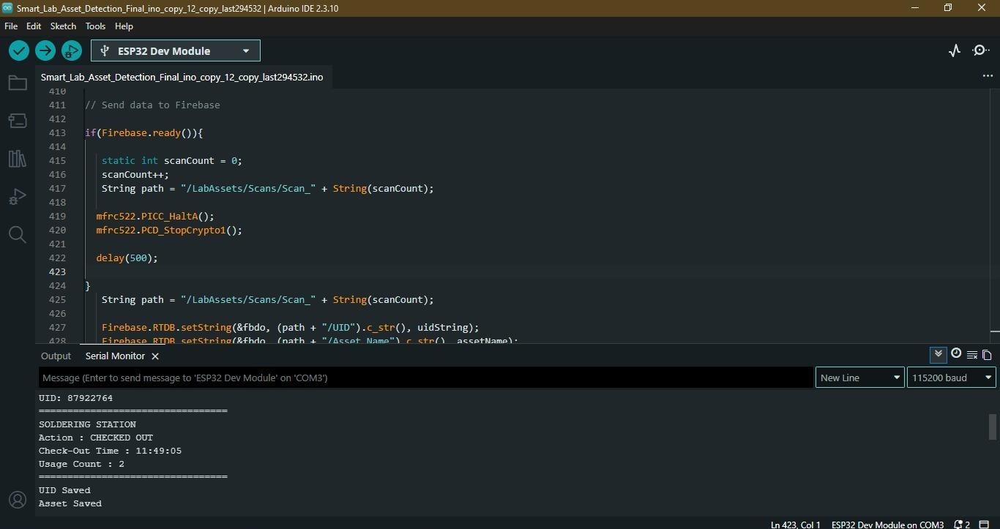
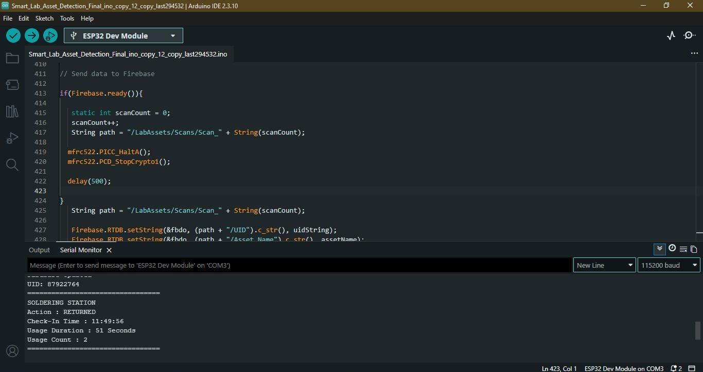
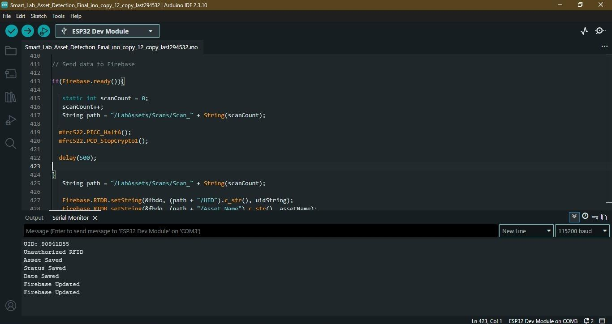
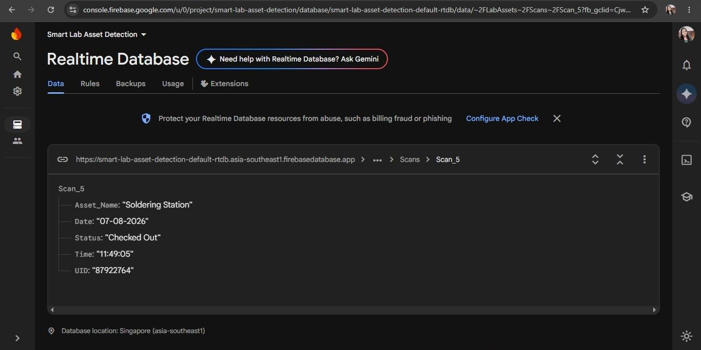
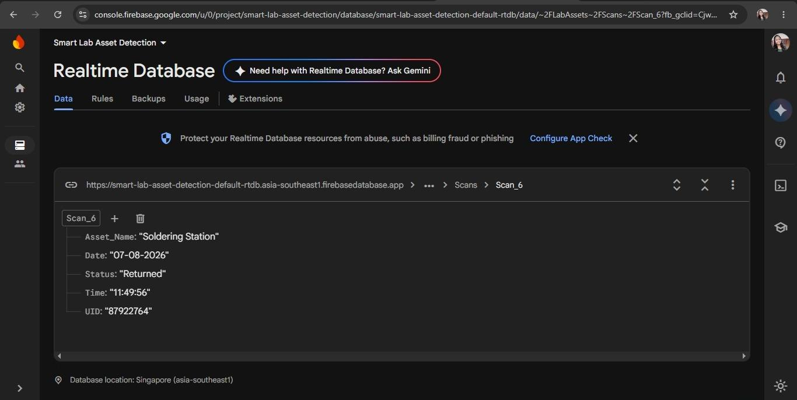
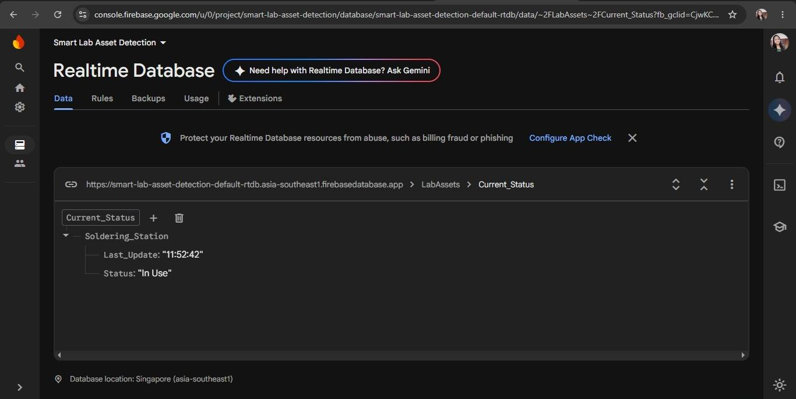
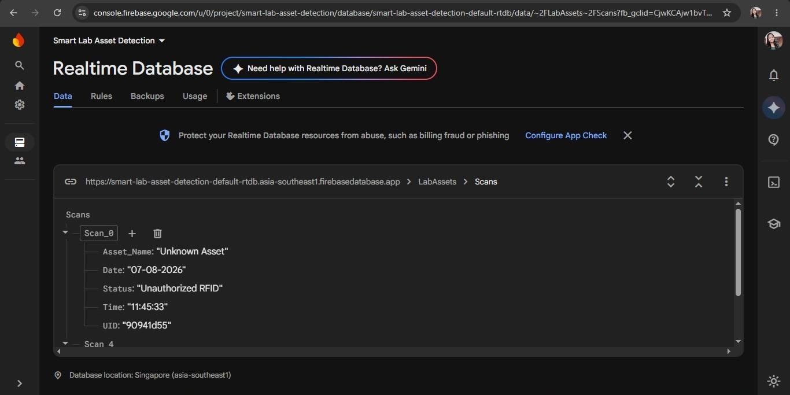

# IoT-Based Smart Laboratory Asset Management and Digital Logging System Using RFID

An ESP32- and RFID-based laboratory asset-management prototype. The project report describes RFID identification, asset check-out/check-in, usage logging, Firebase Realtime Database storage, and LED/buzzer alerts for unknown tags.

## Project overview

The documented prototype uses an MFRC522 RFID reader connected to an ESP32. The ESP32 reads a tag UID, checks whether it is registered, and provides visual/audio feedback. Wi-Fi and Firebase are used for cloud-based records.

## Hardware

- ESP32 development board
- MFRC522 13.56 MHz RFID reader
- RFID card and key tag
- Green LED and red LED
- Active buzzer
- Breadboard, jumper wires, USB cable

## Pin connections (as documented in the project report)

| ESP32 pin | Component | Purpose |
|---|---|---|
| GPIO 5 | MFRC522 SDA/SS | Chip select |
| GPIO 18 | MFRC522 SCK | SPI clock |
| GPIO 23 | MFRC522 MOSI | SPI data to reader |
| GPIO 19 | MFRC522 MISO | SPI data from reader |
| GPIO 22 | MFRC522 RST | Reset |
| 3.3 V | MFRC522 VCC | Power |
| GND | MFRC522 GND | Ground |
| GPIO 26 | Green LED | Authorized indication |
| GPIO 27 | Red LED | Unauthorized indication |
| GPIO 25 | Active buzzer | Unauthorized alert |

## Software and libraries

- Arduino IDE
- ESP32 board package
- MFRC522 library
- Firebase ESP Client library (`Firebase_ESP_Client.h`)
- WiFi and SPI libraries (included with ESP32 Arduino core)

Install the libraries through Arduino IDE Library Manager or the library authors' official distribution channels. The original third-party library folders from the submitted ZIP are not duplicated in this repository.

## Source code included

The submitted ZIP contains separate sketches for testing the RFID reader, Wi-Fi, and Firebase connectivity. They are retained as separate module sketches under `src/`.

**Important implementation note:** The source files supplied for this repository do not include one integrated sketch implementing the complete check-out/check-in + usage-duration/count + Firebase logging workflow described in the report. The screenshots below are taken from the supplied technical report and document the reported prototype tests; they should not be interpreted as proof that the included sketches alone reproduce every reported feature.

## Working-system screenshots

The following screenshots were extracted from the project's technical report.

### Serial Monitor

| Check-out | Return |
|---|---|
|  |  |



### Firebase records










## Getting started

1. Install Arduino IDE and the ESP32 board package.
2. Install the MFRC522 and Firebase ESP Client libraries.
3. Open the required module sketch from `src/` in Arduino IDE.
4. For Firebase sketches, replace the placeholder configuration values with your own credentials locally. Do not commit real credentials.
5. Select the correct ESP32 board and COM port, then compile and upload.
6. Open Serial Monitor at the baud rate configured in the sketch (115200 for the RFID test sketch).

## Security

- Do not commit Wi-Fi passwords, Firebase passwords, private keys, or other credentials.
- The credential values in the included Firebase sketches have been replaced with placeholders.
- Configure Firebase Realtime Database rules and authentication securely before using this outside a controlled demonstration.

## Repository structure

```text
.
├── README.md
├── .gitignore
├── src/
│   ├── RFID_Test/RFID_Test.ino
│   ├── Firebase_Test/Firebase_Test.ino
│   └── WiFi_Test/IoT_Smart_Lab_Firebase.ino
└── screenshots/
    ├── 01-serial-monitor-checkout.jpeg
    ├── 02-serial-monitor-return.jpeg
    ├── 03-serial-monitor-unauthorized-rfid.jpeg
    ├── 04-firebase-checkout-record.jpeg
    ├── 05-firebase-current-status-checkout.jpeg
    ├── 06-firebase-return-record.jpeg
    ├── 07-firebase-current-status-return.jpeg
    └── 08-firebase-unauthorized-event.jpeg
```

## Acknowledgements

This prototype uses the ESP32 platform, NXP MFRC522 RFID reader, Arduino IDE, and Firebase Realtime Database. Refer to their official documentation for hardware and software details.
